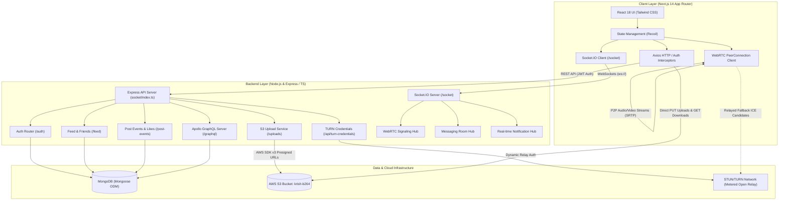
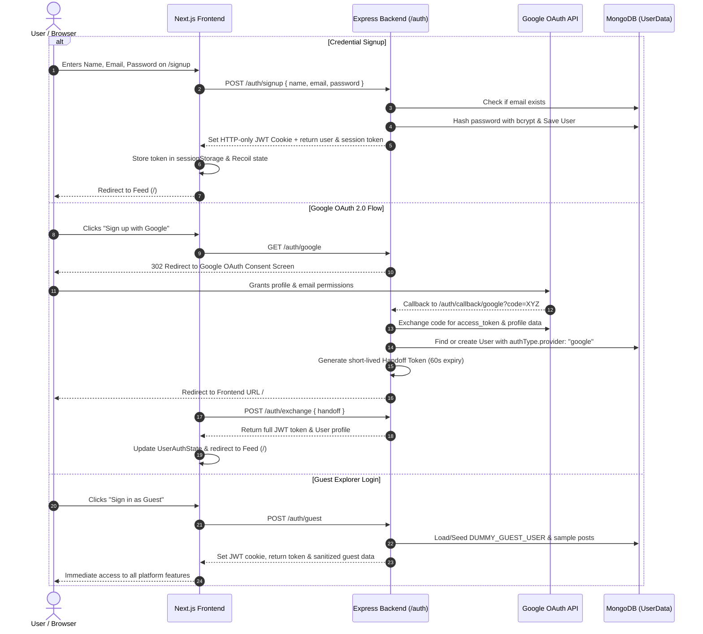
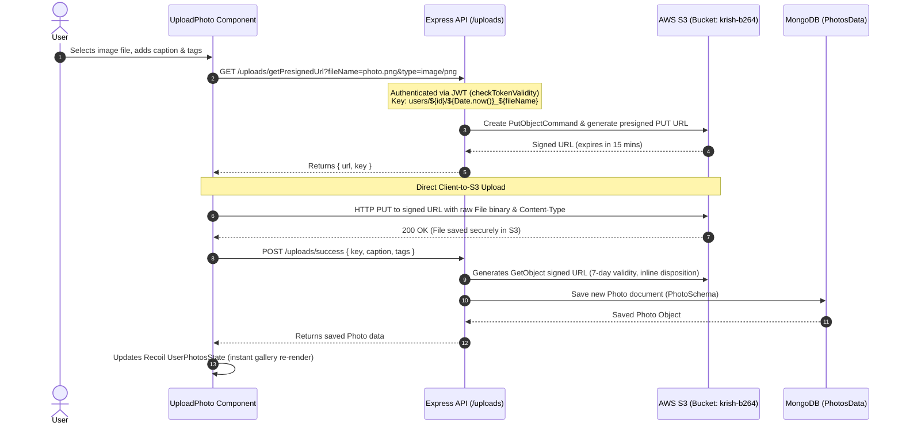
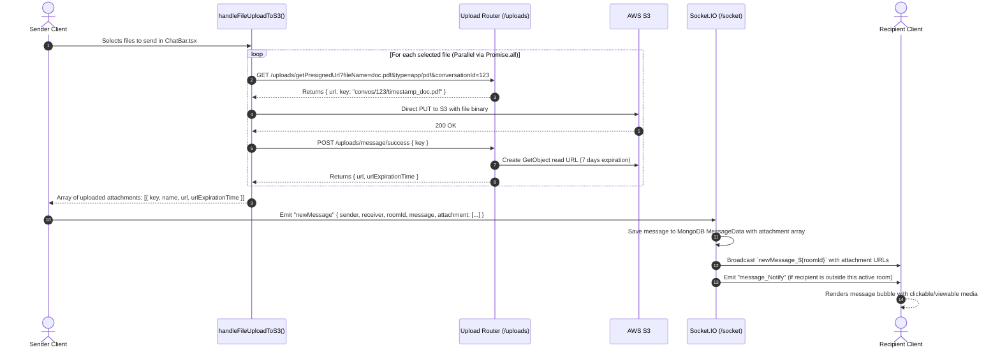

# Social Sphere: End-to-End Architecture & Feature Workflows

This document provides a comprehensive end-to-end architectural specification, system design, and detailed user flow documentation for the **Social Sphere** application.

---

## Table of Contents
1. [Executive Summary & High-Level Architecture](#1-executive-summary--high-level-architecture)
2. [Technology Stack](#2-technology-stack)
3. [User Onboarding & Profile Creation](#3-user-onboarding--profile-creation)
4. [File Sharing WITHOUT Messages (Posts & Avatars)](#4-file-sharing-without-messages-posts--avatars)
5. [File Sharing WITH Messages (Chat Attachments)](#5-file-sharing-with-messages-chat-attachments)
6. [Real-Time Messaging & Presence Architecture](#6-real-time-messaging--presence-architecture)
7. [WebRTC Audio & Video Calling Architecture](#7-webrtc-audio--video-calling-architecture)
8. [Social Graph & Notifications System](#8-social-graph--notifications-system)
9. [API, Socket & Schema Reference](#9-api-socket--schema-reference)

---

## 1. Executive Summary & High-Level Architecture

Social Sphere is a real-time social networking platform integrating social discovery, rich media feeds, real-time messaging, and peer-to-peer WebRTC audio/video communications.

### System Architecture Diagram



---

## 2. Technology Stack

| Layer | Technologies & Libraries | Key Responsibilities |
|---|---|---|
| **Frontend** | Next.js (App Router), React 18, Recoil, Tailwind CSS, Material UI Icons | UI rendering, client state, media feeds, WebRTC elements, responsive layouts |
| **Backend** | Node.js, Express.js, TypeScript, Apollo Server Express | REST API, JWT session cookies, rate-limiting, route authentication |
| **Real-time** | Socket.IO, WebRTC (`RTCPeerConnection`), STUN/TURN (Metered Open Relay) | Signaling, live chat, presence tracking, direct peer-to-peer media streaming |
| **Storage & DB** | MongoDB (Mongoose ODM), AWS S3 (`@aws-sdk/client-s3`) | Document persistence (Users, Chats, Posts, Notifications), cloud media storage |
| **Security** | `bcrypt`, `jsonwebtoken` (JWT), HTTP-only cookies, Presigned URLs | Encrypted passwords, cross-origin handoff tokens, direct-to-cloud pre-signed uploads |

---

## 3. User Onboarding & Profile Creation

Social Sphere supports three authentication mechanisms: Credential-based registration, Google OAuth 2.0, and 1-Click Guest Access.



### Profile Personalization & Live View Tracking

1. **Profile Personalization**:
   - Navigation: `/my-profile/edit-profile`.
   - Modifiable fields: `name`, `userName`, `intro`, `pronouns`, `gender`, `country`, `intrests`, `places_want_to_visit`, `languages_learning_or_speak`, and avatar picture.
   - Updates are sent to `POST /uploads/update-profile` which executes `UserService.updateUserProfile()`.

2. **Real-time Profile View Tracking**:
   - When User A views User B's profile page at `/profile?id=<UserB_ID>`:
   - Frontend calls `GET /feed/getUser?id=<UserB_ID>`.
   - If User A $\neq$ User B, the backend:
     1. Creates a notification in MongoDB: `{ type: "viewed-profile", notifier: UserA, target: { userId: UserB } }`.
     2. Finds User B's active `socketID` from MongoDB.
     3. Emits a real-time `notification` socket event to User B's client so a live toast appears immediately.

---

## 4. File Sharing WITHOUT Messages (Posts & Avatars)

Social Sphere implements a direct-to-cloud upload pattern via **AWS S3 Presigned URLs**. Large media files bypass the Node.js API server entirely.



---

## 5. File Sharing WITH Messages (Chat Attachments)

When sending files inside a conversation, multiple files (images, documents, PDFs) can be shared simultaneously.



---

## 6. Real-Time Messaging & Presence Architecture

1. **Deterministic Room IDs**:
   One-on-one chat rooms use a deterministic room ID created by sorting and joining both participant IDs:
   $$\text{Room ID} = [\text{UserId}_1, \text{UserId}_2].\text{sort}().\text{join}(\text{"-"})$$

2. **Presence & Socket Registration**:
   - On socket connection, the client fires `newUserConnected(user)`.
   - The backend records the `socketID` and sets `isConnected: true` in the MongoDB `User` document.
   - On socket disconnect, `socketID` is cleared and `isConnected` set to `false`.

3. **Message Delivery & Status**:
   - `startConvo`: Ensures both sender and recipient sockets join the designated room.
   - `newMessage`: Saves message to MongoDB, broadcasts to `newMessage_${roomId}`, and sends background notification `message_Notify` to the recipient's personal socket.
   - Supports message replies via `repliedTo` field linking to earlier `MessageData` documents.

---

## 7. WebRTC Audio & Video Calling Architecture

Social Sphere provides peer-to-peer audio and video calling with NAT traversal (STUN + Metered TURN Relay fallback) and a floating minimized call window overlay.

```mermaid
sequenceDiagram
    autonumber
    actor Alice as Caller (Alice)
    participant Socket as Socket.IO Signaling Server
    participant TurnAPI as /api/turn-credentials
    actor Bob as Receiver (Bob)

    Alice->>TurnAPI: GET /api/turn-credentials (fetches STUN + Metered TURN servers)
    Bob->>TurnAPI: GET /api/turn-credentials
    Alice->>Alice: Acquire Local MediaStream (navigator.mediaDevices.getUserMedia)
    Alice->>Alice: Create RTCPeerConnection with ICE servers

    Alice->>Alice: Create Offer (SDP)
    Alice->>Socket: Emit "offer" { offer, guest: Bob, offerer: Alice }
    Socket->>Bob: Forward "offer" to Bob's socketID

    alt Bob Accepts Call
        Bob->>Bob: Acquire Local MediaStream
        Bob->>Bob: SetRemoteDescription(offer) & Create Answer (SDP)
        Bob->>Socket: Emit "answer" { answer, guest: Alice, offerer: Bob }
        Socket->>Alice: Forward "answer" to Alice
        Alice->>Alice: SetRemoteDescription(answer)

        par ICE Candidate Exchange
            Alice->>Socket: Emit "candidate" { iceCandidateBuffer, guest: Bob }
            Socket->>Bob: Forward ICE candidate
            Bob->>Socket: Emit "candidate" { iceCandidateBuffer, guest: Alice }
            Socket->>Alice: Forward ICE candidate
        end

        Note over Alice,Bob: P2P Media Connection Established (Direct or TURN Relayed)
        Alice<-->>Bob: Real-Time Encrypted Video/Audio Stream (SRTP)
    else Bob is Busy or In Another Call
        Bob->>Socket: Emit "busy" { guest: Bob, offerer: Alice }
        Socket->>Alice: Forward "user-busy" event
        Alice->>Alice: Show "User is busy" banner & tear down peer connection
    end

    Note over Alice,Bob: In-Call Controls
    Alice->>Socket: Emit "media-state" { audio: false, video: true } (Mute/Camera Off)
    Socket->>Bob: Forward "media-state" (Updates remote avatar/mute indicator)

    Alice->>Socket: Emit "end-call"
    Socket->>Bob: Forward "call-ended"
    Alice->>Alice: Close PeerConnection, stop local tracks & hide CallWindow
    Bob->>Bob: Close PeerConnection, stop local tracks & hide CallWindow
```

### Minimized Call Window
- Enables continuous audio/video communication while navigating through the rest of the application.
- Supports switching between fullscreen overlay and a picture-in-picture floating overlay without interrupting the peer connection.

---

## 8. Social Graph & Notifications System

### Friendship Lifecycle
Managed with ACID MongoDB transactions in `FriendService`:
- **Send Friend Request**: Adds requester to target's `friendRequests` array, and target to requester's `sentRequests` array.
- **Accept Friend Request**: Moves IDs from `friendRequests`/`sentRequests` into `friends` on both user documents atomically using a MongoDB session transaction; emits `friend-request-accepted` notification.
- **Decline / Cancel Request**: Removes IDs from respective arrays.
- **Unfriend**: Removes IDs from both users' `friends` lists.

### Post Interactions & Aggregation Pipeline
- **Feed**: Aggregated list of photos sorted by upload date, with uploader details populated.
- **Likes & Comments**: Users can like or comment; triggers `NotificationService.createNotification` to alert the content creator.
- **Notifications Hub**: Uses MongoDB Aggregation (`$match`, `$sort`, `$limit: 15`, `$lookup` from `users`, `$unwind`, and `$project`) to fetch enriched notification cards with commenter/liker avatars and timestamps.

---

## 9. API, Socket & Schema Reference

### REST API Endpoints

| Endpoint | Method | Middleware | Description |
|---|---|---|---|
| `/auth/signup` | POST | None | Creates credential account with bcrypt password |
| `/auth/login` | POST | None | Authenticates credentials and issues JWT cookie |
| `/auth/google` | GET | None | Initiates Google OAuth redirection flow |
| `/auth/callback/google` | GET | None | Google OAuth callback; issues handoff token |
| `/auth/exchange` | POST | None | Exchanges handoff token for full JWT token |
| `/auth/guest` | POST/GET | None | One-click login using dummy guest account |
| `/feed/getFeedUsers` | GET | None | Returns list of platform users for discovery |
| `/feed/getUser` | GET | `checkTokenValidity` | Retrieves user profile and triggers profile view notification |
| `/feed/relationlist` | GET | `checkTokenValidity` | Retrieves friends, incoming, or sent request lists |
| `/feed/accept-request` | POST | `checkTokenValidity` | Accepts incoming friend request |
| `/feed/unfriend` | POST | `checkTokenValidity` | Removes bidirectional friend connection |
| `/uploads/getPresignedUrl` | GET | `checkTokenValidity` | Generates AWS S3 signed PUT URL for direct upload |
| `/uploads/success` | POST | `checkTokenValidity` | Finalizes photo post creation with S3 key |
| `/uploads/message/success`| POST | `checkTokenValidity` | Finalizes message attachment and generates 7-day read URL |
| `/uploads/update-profile` | POST | `checkTokenValidity` | Updates user profile metadata and avatar URL |
| `/post-events/liked` | POST | `checkTokenValidity` | Likes or dislikes a photo post |
| `/post-events/postComment`| POST | `checkTokenValidity` | Adds comment and notifies post uploader |
| `/api/turn-credentials` | GET | `checkTokenValidity` | Returns Metered STUN/TURN ICE server configuration |

### Socket.IO Events

| Namespace/Event | Direction | Purpose |
|---|---|---|
| `newUserConnected` | Client $\to$ Server | Registers user ID to socket ID and marks user online |
| `startConvo` | Client $\to$ Server | Joins both parties into deterministic chat room |
| `newMessage` | Client $\to$ Server | Submits chat message & attachments; persists to DB |
| `newMessage_${roomId}` | Server $\to$ Room | Broadcasts message to all clients currently inside chat room |
| `message_Notify` | Server $\to$ User | Push notification to recipient if outside room |
| `notification` | Server $\to$ User | Live notification for likes, comments, friend requests, views |
| `offer` / `answer` | Bidirectional | WebRTC SDP offer and answer exchange |
| `candidate` / `guest-candidate`| Bidirectional | WebRTC ICE candidate signaling for NAT traversal |
| `media-state` | Bidirectional | Syncs mic mute and camera toggle status in live call |
| `busy` / `user-busy` | Bidirectional | Relays busy notification when callee is in another call |
| `end-call` / `call-ended` | Bidirectional | Signals call hang-up and triggers resource cleanup |

### Database Schemas (MongoDB Mongoose)

- **`User`** (`userSchema.ts`): Stores user credentials, email, profile avatar, personal metadata (age, gender, pronouns, interests, languages, travel wishlist), socket ID, and connection status.
- **`Messages`** (`chatSchema.ts`): Stores sender, recipient, text content, conversation ID, status (`sent`, `delivered`, `read`), reply reference (`repliedTo`), and attachment list (`url`, `key`, `type`, `size`, `urlExpirationTime`).
- **`Conversation`** (`chatSchema.ts`): Stores conversation participants and timestamps.
- **`Friends`** (`chatSchema.ts`): Stores user friend list, pending friend requests, and sent requests.
- **`Photo`** (`photoSchema.ts`): Stores S3 key, presigned image URL, uploader reference, likes array, comments array, caption, and tags.
- **`Comment`** (`commentSchema.ts`): Stores commenter profile snapshot, associated post ID, content, and creation timestamp.
- **`Notification`** (`notificationSchema.ts`): Stores notification type (`viewed-profile`, `commented`, `friend-request-accepted`, etc.), notifier, target user/media ID, and timestamp.
